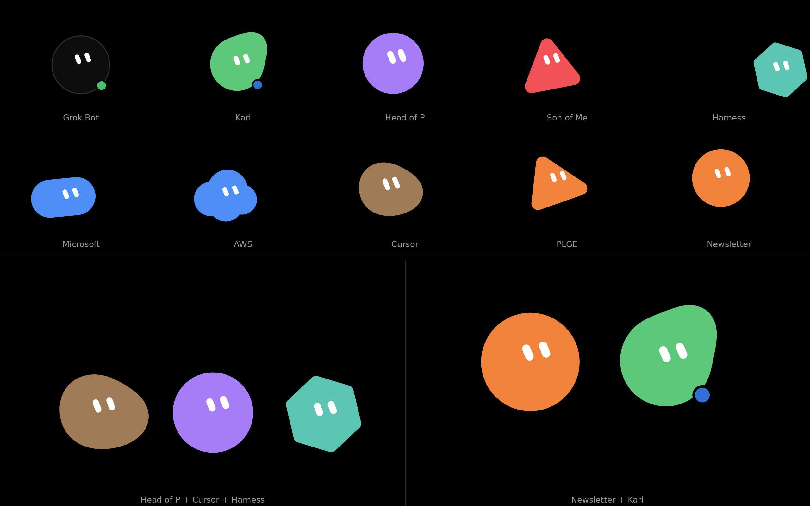

# Grok Bot Face

[](LICENSE)

A fullscreen, animated Grok Bot face for a Google Pixel Tablet. It runs as an app and as the tablet's screensaver (Android "Daydream"), so the dock always has a little character on it.



## What it does

- **Pill eyes with personality.** The bot blinks (sometimes twice), looks around, and does goofy moves on its own. It drifts slowly to avoid screen burn-in and dozes off when nobody is around.
- **Sees and hears you, on the device only.** Camera and mic are analysed in memory, frame by frame, and never stored or sent anywhere. It follows faces, smiles back, waves back, reacts to claps and loud sounds, and bounces along to music it detects.
- **"Hey Grok Bot" wake word.** Offline speech recognition (Vosk). The bot perks up and opens the Grok Bot Android app. A long-press anywhere, or a tap on the wordmark, opens it too.
- **Looks that rotate on their own** (or swipe between them): pill eyes, blob, a cast of character bots, a big clock, Pong played by two bots around the clock, chess, checkers, Pac-Man, a news page, and a "harness board" of coding-agent changelogs (Claude Code, Codex, Cursor, Goose, OpenCode, Grok Build, Antigravity).
- **Small clock on every look**, so it works as a desk clock.
- **Grok Bot adventures:** short animated skits (building, coding, collaborating, writing, dreaming, multiplying, coordinating, tug of war).
- **Optional plan-usage meter:** a small gauge showing Cursor plan spend versus limit.
- **Optional AI news moments:** calm center-screen headlines with short summaries, plus a "THIS JUST IN" takeover for fresh coding-agent releases.

The usage meter and news come from a small Cloudflare Worker (`usage-feed/`). If you build without a feed URL, the app gets no INTERNET permission and makes no network calls at all.

## Repo layout

```
index.html            the whole face: rendering, looks, games, news UI (canvas, no framework)
sense/                on-device camera + mic sensing (MediaPipe face/gesture, audio worklet)
  fetch-mediapipe.sh  downloads MediaPipe + models at build time and strips its telemetry
android/
  build.sh            Gradle-less build: aapt2 -> javac -> d8 -> zipalign -> apksigner
  src/                AndroidManifest, Java (WebView host, screensaver, native mic, wake word), resources
  vendor/fetch-vendor.sh  downloads Vosk, JNA and the small English Vosk model at build time
usage-feed/           Cloudflare Worker serving usage.json, news.json and harness.json
tests/                headless Playwright checks for rotation, news and news moments
docs/                 screenshot
```

No third-party binaries or models are checked in. The fetch scripts download them on the first build.

## Build

You need:
- JDK 17 (set `JAVA_HOME`, or install it as `~/opt/jdk-17*`)
- Android SDK with `build-tools;35.0.0` and `platforms;android-34` (set `ANDROID_SDK_ROOT`, default `~/opt/android-sdk`)
- `curl`, `unzip`, `zip`, `python3`, and `npm` (for the MediaPipe download)

```bash
# optional: point the app at your feed (https only)
export USAGE_FEED_URL=https://<worker>.<subdomain>.workers.dev/<FEED_TOKEN>/usage.json
./android/build.sh          # -> android/grokbot-face.apk
```

**Signing:** use your own keystore with `KEYSTORE=/path/to/your.keystore KS_PASS=... KS_ALIAS=...` (or put those in a git-ignored `android/local.env`). With no keystore, the first build generates a throwaway debug key at `android/debug.keystore`. Keep whichever key you use: an APK signed with a different key won't install over the existing app. Keystores are git-ignored, so never commit one.

## Install on the tablet (adb over Wi-Fi)

1. On the tablet, turn on Developer options and then **Wireless debugging**, and pair it once (`adb pair <TABLET_IP>:<PAIR_PORT>`).
2. Then:

```bash
adb connect <TABLET_IP>:<PORT>
adb install -r android/grokbot-face.apk
```

3. Allow camera and microphone when the app asks. To use it as the screensaver, go to **Settings > Display > Screen saver** and pick **Grok Bot Face**.

## Usage-feed Worker (optional)

`usage-feed/` is a Cloudflare Worker with one KV namespace and Workers AI. A cron reads your Cursor plan spend (Cursor Admin API) every 15 minutes. A second cron collects AI news and coding-agent changelogs and summarizes new items. Everything is served behind a secret URL token (wrong token = 404), and CORS is limited to the app's WebView origin.

```bash
cd usage-feed
cp wrangler.toml.example wrangler.toml        # fill in your KV namespace id + SEARCH_TERM
npx wrangler kv namespace create FEED         # once, if you don't have one
npx wrangler secret put CURSOR_KEY            # Cursor team admin API key
npx wrangler secret put FEED_TOKEN            # random token, >= 20 chars of [A-Za-z0-9_-]
npx wrangler deploy
```

Then build the app with `USAGE_FEED_URL=https://grokbot-usage-feed.<subdomain>.workers.dev/<FEED_TOKEN>/usage.json`. The helper scripts (`enable.sh`, `disable.sh`, `rotate-token.sh`, `bootstrap-news.mjs`) use the Cloudflare REST API and read your IDs from a git-ignored `usage-feed/.env.local` (copy `config.example.env`). See [usage-feed/README.md](usage-feed/README.md) for details.

## Note

This is a personal hobby project. It's unofficial and not affiliated with or endorsed by xAI, Cursor, Google, or anyone else whose product names appear in it. It works on my Pixel Tablet; your mileage may vary.

## License

The code in this repository is released under the [MIT License](LICENSE), Copyright (c) 2026 David Winter. Source files carry `SPDX-License-Identifier: MIT` headers.

Third-party components (Vosk and its English model, JNA, MediaPipe Tasks Vision and its face/gesture models) are downloaded at build time. They keep their own licenses (Apache-2.0, and JNA's Apache-2.0/LGPL dual license) and are not relicensed. See [THIRD_PARTY_NOTICES.md](THIRD_PARTY_NOTICES.md).
